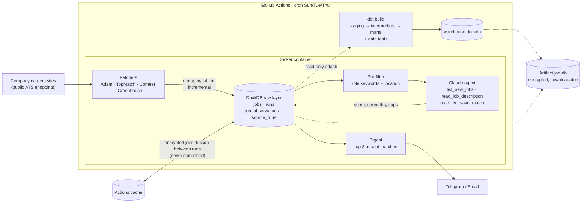

# Job Search Agent

[](https://github.com/tomerdg/job_search_agent/actions/workflows/daily.yml)


An end-to-end data pipeline that runs on a schedule, collects job postings straight from Israeli companies'
careers sites, keeps their full history in DuckDB, uses a Claude tool-calling agent to score only the new
relevant ones against a CV, and sends a short digest with the top 3 matches to Telegram or email.
A dbt project on the same data turns the raw history into hiring-market marts: who hires most,
how long jobs stay open, and which sources stopped working.

**Stack:** Python · DuckDB · dbt (staging → intermediate → marts, data + unit tests) · Claude API (tool use,
prompt caching) · Docker · GitHub Actions (CI on every change, scheduled production run).

## Architecture



## Design decisions

**Go to the source, not LinkedIn.** LinkedIn blocks automated access and its terms forbid scraping, and many
companies post on their own careers site first, or only there. Those sites usually sit on a handful of applicant
tracking systems (Adam, TopMatch, Comeet, Greenhouse) whose pages call public JSON or HTML endpoints. One small
fetcher per ATS covers every company that uses it, so adding a company is a config line, not code.

**Filter before the LLM.** Most postings (sales, QA, customer service, other cities) are obviously irrelevant.
A deterministic keyword + location filter (English and Hebrew) drops them for free before any model call.
Only new jobs that pass it reach Claude, at most 15 per run, so cost stays flat no matter how many sources are
added, and the cheap filter is easy to test. Ambiguous cases (no location given) are passed through and left to the model.

**An agent with tools, not one big prompt.** The model gets four tools and decides what to read. It reads the CV
once, lists the pending jobs, reads each description, and writes a structured result (`score`, `summary`,
`strengths`, `gaps`) through `save_match`, which validates and clamps it. Results land in the database, not in
free text, and the conversation is prompt-cached so each extra turn is cheap.

**Incremental and idempotent.** Each job gets a stable `job_id` (hash of source + company + external id).
A job is "new" only the first time it is seen, is scored once, and is sent once, so re-running the pipeline
never spams the digest or re-pays for scoring.

**History as append-only facts.** `job_observations` (job × run) and `source_runs` (source × run) are never updated.
Durations and source trends can be recomputed with new logic at any time.

**A job closes only when its source worked.** If a careers site breaks and returns nothing, its jobs are not
marked closed. The broken source shows up instead in `mart_source_health` and in a dbt `warn` test.

**Two DuckDB files.** The app owns `jobs.duckdb`. dbt attaches it read-only and builds a separate, disposable
`warehouse.duckdb`, so the analytics layer can never corrupt the raw data. DuckDB fits a single-writer batch job:
an embedded columnar file with no server to run, and fast enough for analytical SQL over the whole history.

**Reproducible "now".** Marts use the latest run time, not the wall clock, so the same database always gives the same result.

**Personal data never enters git.** The CV and search preferences come from GitHub secrets at runtime. The image
holds no personal data, the database is encrypted with a passphrase secret before it touches the Actions cache
or a downloadable artifact (artifacts of a public repo can be downloaded by anyone signed in to GitHub), and the
digest goes only to Telegram or email, never to the log.

## Try it on demo data

No API key and no personal data needed. `jobagent.demo` generates four months of synthetic runs
for made-up companies, including a source that silently stops returning jobs:

```bash
pip install -r requirements.txt -r requirements-dbt.txt
python -m jobagent.demo --db data/demo.duckdb
DBT_RAW_DB=data/demo.duckdb DBT_WAREHOUSE_DB=data/demo_warehouse.duckdb \
  dbt build --project-dir analytics --profiles-dir analytics
python -c "import duckdb; print(duckdb.connect('data/demo_warehouse.duckdb').sql('from marts.mart_company_hiring order by hiring_rank_90d'))"
python -c "import duckdb; print(duckdb.connect('data/demo_warehouse.duckdb').sql('from marts.mart_source_health'))"
```

CI runs exactly this on every change.

## Data layer (DuckDB + dbt)

**Raw tables** (written by `jobagent/db.py`)

| Table | Grain | Purpose |
|---|---|---|
| `jobs` | one job | current state: first/last seen, open or closed, pre-filter result, score, sent |
| `runs` | one pipeline run | run time, jobs fetched, new jobs |
| `job_observations` | job × run, append-only | which jobs were live in each run, for open-duration history |
| `source_runs` | source × run, append-only | fetch ok?, jobs returned, duration: source health over time |

**dbt models** (`analytics/models`)

```
staging       stg_jobs, stg_runs, stg_job_observations, stg_source_runs       views: rename, cast, clean
intermediate  int_job_roles (title → role family, EN + HE), int_job_activity  views
marts         fct_job_postings      one row per job: opened, closed, days open (censoring flagged), role, match band
              dim_companies         company, sector, source, postings
              mart_company_hiring   who hires most (30/90 days), open now, median days to close, rank
              mart_hiring_weekly    opened / closed / open at week end, per sector and week
              mart_time_to_close    p50 / p75 days open by sector and role family
              mart_source_health    last fetch per source, empty runs in a row: ok / degraded / down
```

**Tests:** `unique`, `not_null`, `accepted_values` and `relationships` on keys and enums; a custom generic
`unique_combination` test for composite grains; singular tests (dates in order; open jobs were seen in the
latest good run of their source); a dbt **unit test** for the Hebrew/English role classifier; and a `warn` test
that fires when a source returned nothing three runs in a row.

## Project layout

| Part | Where |
|---|---|
| Fetchers, one per ATS | `jobagent/fetchers/` |
| Source list (company → ATS + public board id) | `config/sources.yaml` |
| Pre-filter | `jobagent/filters.py` |
| Raw storage, dedup, history | `jobagent/db.py` |
| Claude agent and tools | `jobagent/agent.py` |
| Digest (Telegram / email) | `jobagent/notify.py` |
| dbt project | `analytics/` |
| Synthetic demo data | `jobagent/demo.py` |
| Pipeline (CI + schedule) | `.github/workflows/daily.yml` |

## Run it for real

```bash
python -m venv .venv && source .venv/bin/activate
pip install -r requirements.txt
pytest -q
cp config/profile.example.yaml config/profile.yaml   # roles, keywords, locations, CV path (git-ignored)
python -m jobagent.main --no-llm --no-notify          # fetch + filter only
ANTHROPIC_API_KEY=... python -m jobagent.main --no-notify
```

Docker:

```bash
docker build -t job-search-agent .
docker run --rm -e ANTHROPIC_API_KEY -v "$PWD/data:/app/data" -v "$PWD:/repo:ro" \
  -e PROFILE_PATH=/repo/config/profile.yaml -e CV_PATH=/repo/<your-cv>.pdf job-search-agent --no-notify
```

Jobs already handled by hand can be skipped in future digests with `--mark-seen` / `--mark-printed`.

### GitHub Actions secrets

| Secret | Needed | What |
|---|---|---|
| `ANTHROPIC_API_KEY` | yes | Claude API key |
| `PROFILE_YAML` | yes | full contents of `config/profile.yaml` |
| `CV_TEXT` | yes | CV as plain text (phone and email are stripped before it reaches the model) |
| `TELEGRAM_BOT_TOKEN`, `TELEGRAM_CHAT_ID` | for Telegram | bot from @BotFather; chat id from `getUpdates` |
| `SMTP_HOST`, `SMTP_USER`, `SMTP_PASSWORD`, `EMAIL_TO` | for email | e.g. Gmail with an app password |
| `DB_PASSPHRASE` | recommended | long random passphrase that encrypts the job database in the cache and in the downloadable artifact. Keep a copy, it is needed to open the download. Without it the cache is unencrypted and nothing is uploaded |

Run it by hand from the Actions tab (`daily-job-search` → Run workflow). The model is set by `CLAUDE_MODEL`
(default `claude-sonnet-5-5`), and the per-run cap by `BATCH` in `jobagent/agent.py`.

### Where personal data lives

| What | Locally | In GitHub Actions |
|---|---|---|
| CV | path in `config/profile.yaml` or `CV_PATH` | secret `CV_TEXT` |
| Preferences (roles, keywords, locations) | `config/profile.yaml` | secret `PROFILE_YAML` |
| Job history + scores | `data/jobs.duckdb` | Actions cache, encrypted with `DB_PASSPHRASE`, never committed |
| dbt marts | `data/warehouse.duckdb` | built on the runner; the log shows only test counts |
| Downloadable copy of both | | artifact `job-db` on each run, encrypted with `DB_PASSPHRASE`, kept 30 days |
| Digest | printed with `--no-notify` | Telegram / email only |

`.gitignore` blocks `*.pdf`, `*.docx`, `cv.*`, `config/profile.yaml`, `data/*.db`, `data/*.duckdb` and `data/*.csv`.

### Query your job history

Each scheduled run uploads `jobs.duckdb` (raw history, scores) and `warehouse.duckdb` (dbt marts) as one encrypted
artifact, `job-db`. To get it:

1. Actions tab → latest `daily-job-search` run → **Artifacts** → `job-db` (or `gh run download -n job-db`).
2. Unzip it into the repo folder and decrypt:

```bash
unzip job-db.zip                       # skip if gh run download already unpacked it
read -s DB_PASSPHRASE && export DB_PASSPHRASE
scripts/dbcrypt.sh decrypt job-db.tar.gz.enc job-db.tar.gz
mkdir -p data && tar -xzf job-db.tar.gz -C data && rm job-db.tar.gz job-db.tar.gz.enc
```

3. Query it with the DuckDB CLI (`brew install duckdb`) or Python:

```bash
duckdb -readonly data/jobs.duckdb "select company, title, score, analysis->>'gaps' as gaps from jobs where score is not null order by score desc limit 20"
duckdb -readonly data/warehouse.duckdb "from marts.mart_company_hiring order by hiring_rank_90d"
python -c "import duckdb; print(duckdb.connect('data/warehouse.duckdb', read_only=True).sql('from marts.mart_source_health'))"
```

The download replaces any local `data/jobs.duckdb`, so if you also run the agent locally, keep one of the two as
the main copy. Artifacts expire after 30 days, but every run uploads a fresh full copy.
